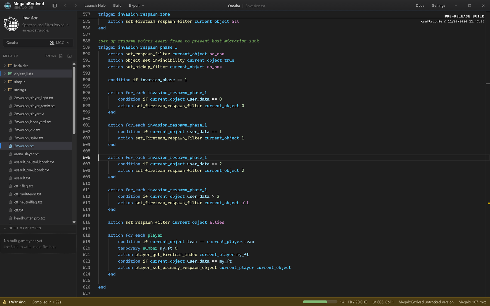
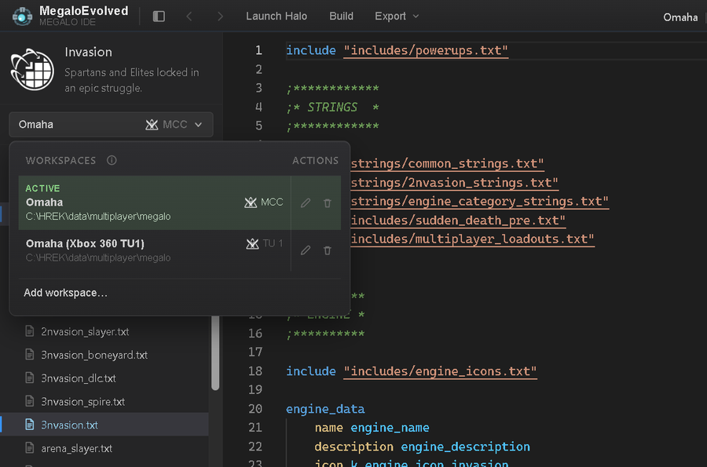
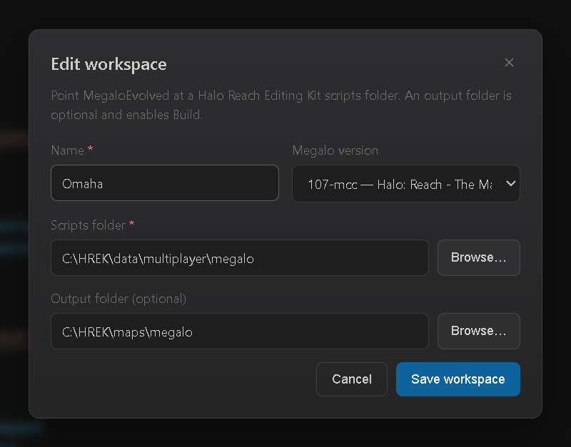
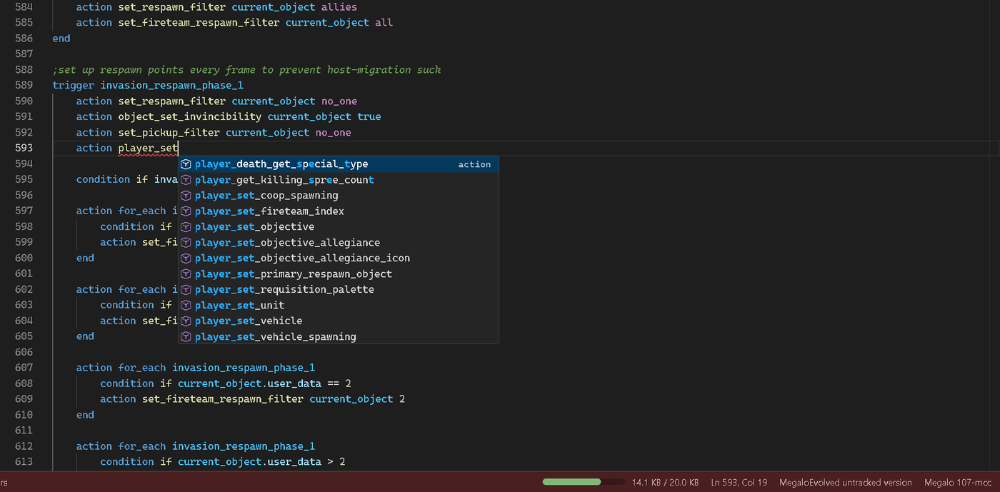
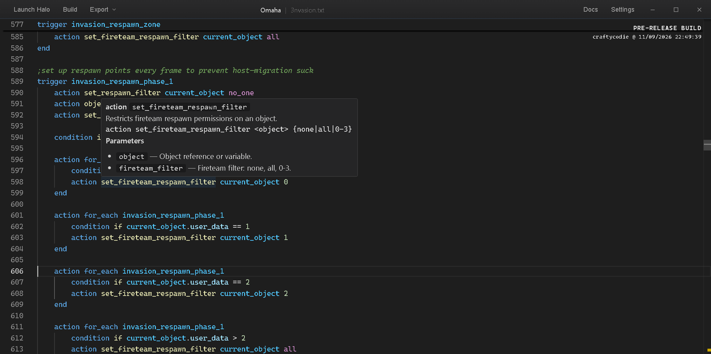
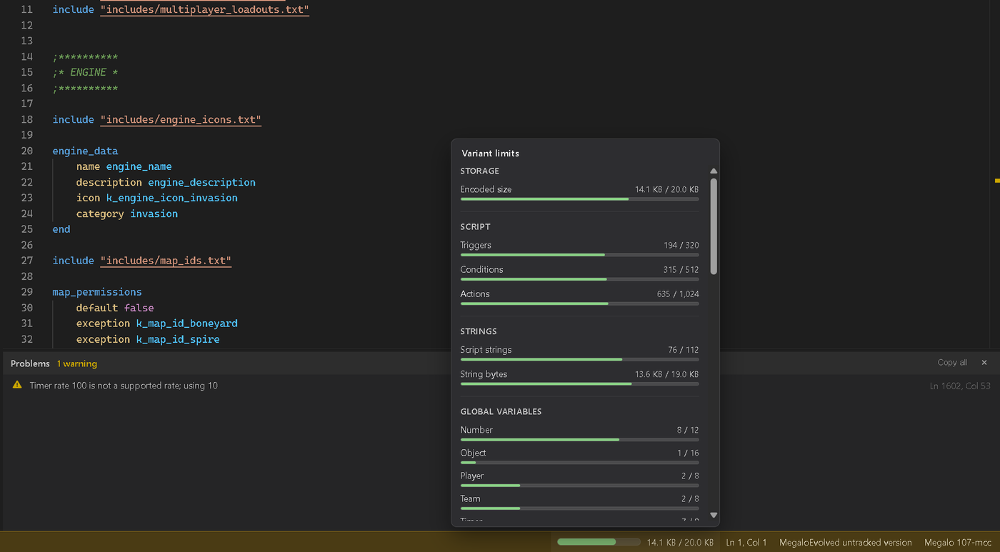
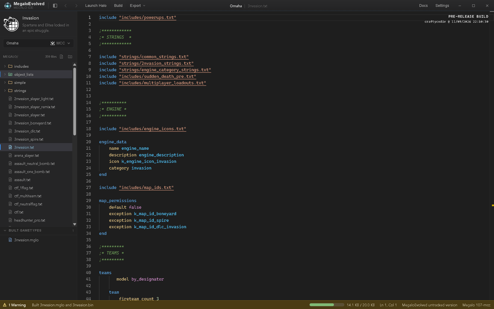
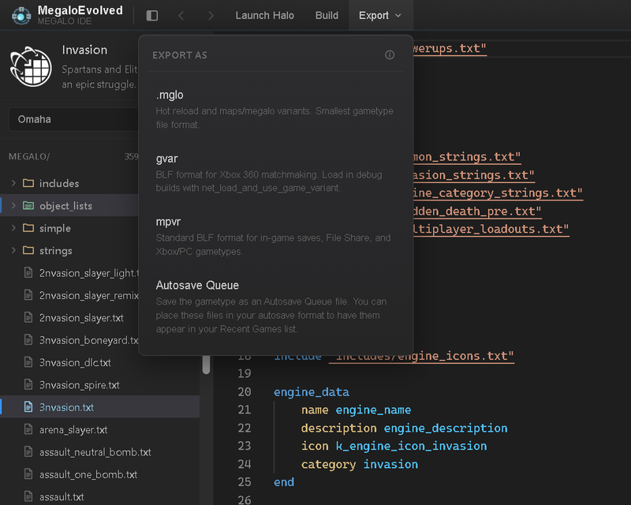
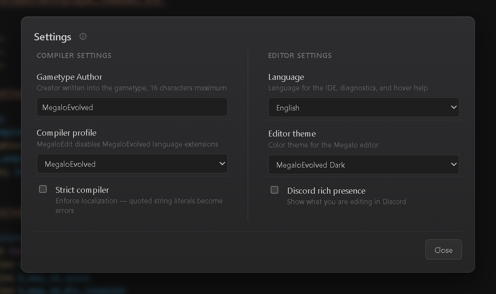

# MegaloEvolved

An IDE and language server for **Megalo**, the scripting language behind Halo: Reach gametypes.



MegaloEvolved compiles Megalo scripts to the same binaries as MegaloEdit, the Halo Reach Editing Kit (HREK) compiler. It adds a proper editor around them: highlighting, completion, hover documentation, live diagnostics and one-click builds into your HREK maps folder.

This repository has two ways to use it:

- **[MegaloEvolved IDE](#megaloevolved-ide)**: a desktop editor for Windows, macOS and Linux, with a browser version.
- **[VS Code extension](#vs-code-extension)**: the same language server, inside Visual Studio Code.

Full documentation, including the Megalo language reference, is built into the IDE (**Docs** in the toolbar). Its source is in [`packages/docs`](packages/docs).

## MegaloEvolved IDE

### Workspaces

A workspace points the IDE at a Megalo scripts folder, usually your HREK `data\multiplayer\megalo` folder. The Files panel then lists every script, include and object list in it. Includes and `base` files resolve relative to that folder, just as they do in MegaloEdit.

Switch between workspaces from the menu at the top of the Files panel. Each workspace remembers its Megalo version and the last file you had open, so you can keep separate setups, such as MCC and Xbox 360 TU1, for the same scripts.



A workspace has:

- **Name**: filled in from HREK's `project.xml` when you pick a scripts folder.
- **Megalo version**: which Megalo build to compile for, such as `107-mcc` (Halo: Reach on MCC) or `107` (Xbox 360 Title Update 1).
- **Scripts folder**: the root of your Megalo sources.
- **Output folder** (optional): where **Build** writes compiled gametypes, usually `maps\megalo`. When you pick an HREK scripts folder, the IDE suggests HREK's `maps\megalo` folder if it exists.



Workspaces are a desktop feature. The browser version keeps your scripts in the browser's own storage instead.

### Editing

The editor understands Megalo, not just its keywords. Completion suggests actions, conditions, variables, object types, strings and the values each parameter accepts.



Hover over any action, condition or element to see what it does, its grammar and its parameters.



Go to definition (F12, or Ctrl+click) jumps to declarations and into included files. Back and Forward in the toolbar retrace your steps.

### Diagnostics and variant limits

Scripts compile as you type. Errors and warnings appear inline and in the **Problems** panel, and the status bar shows whether the last compile succeeded.

Halo: Reach gives each gametype a fixed amount of space. The meter in the status bar shows how much of the 20 KB variant budget the script uses. Click it for a breakdown of every limit: triggers, conditions, actions, strings, variables and more. The meter turns red when any limit is exceeded, so you find out before the game does.



### Build and export

**Build** compiles the open script and writes `.mglo` and `.bin` files to the workspace's output folder. Compiled files appear under **Built gametypes** in the Files panel.

On Windows with an MCC workspace, every successful compile is also copied to MCC's hot-reload folder, so a running game picks up your changes without a restart.



**Export** saves the compiled gametype in the format you need:

| Format | Use it for |
| --- | --- |
| `.mglo` | Hot reload and HREK `maps\megalo` workflows; the smallest format |
| `gvar` | Xbox 360 matchmaking; load in debug builds with `net_load_and_use_game_variant` |
| `mpvr` | Normal gametype files for in-game saves, File Share, and Xbox or PC |
| Autosave Queue | Gametypes that show up under Recent Games |



### Settings

Settings cover the compiler and the editor:

- **Gametype Author**: the creator name written into compiled gametypes.
- **Compiler profile**: MegaloEvolved, with its language extensions, or MegaloEdit, for stock HREK behaviour.
- **Strict compiler**: turns unlocalised string literals into errors.
- **Editor**: language (English or Japanese), editor theme and Discord rich presence.



### Command line

The IDE also compiles scripts from the command line, which is handy for build scripts and CI:

```sh
MegaloEvolved.exe --compile <source.txt> [destination.mglo]
MegaloEvolved.exe --compile-directory <source_dir> [destination_dir]
```

From a checkout, run the same commands with `npm run cli -w @megacrow/ide -- --compile …`.

### Running from source

You need Node.js 20 or later. The desktop app also needs the [Tauri prerequisites](https://v2.tauri.app/start/prerequisites/) (Rust and the platform WebView).

```sh
npm install

# Desktop app
npm run tauri:dev -w @megacrow/ide

# Browser version at http://localhost:5173
npm run dev -w @megacrow/ide
```

## VS Code extension

**MegaloEvolved LSP** brings the IDE's language server to Visual Studio Code: highlighting, completion, hover documentation, go to definition and diagnostics for Megalo scripts.

Megalo scripts are `.txt` files, so VS Code doesn't detect them automatically. Open a script and set its language to **Megalo** with **Change Language Mode**. The first time, the extension asks which Megalo version the script targets.

### Install

Download the `.vsix` from the [latest release](https://github.com/craftycodie/MegaCrow/releases), then run **Extensions: Install from VSIX…** in VS Code.

### Settings

| Setting | Default | Description |
| --- | --- | --- |
| `megaloevolved.megaloVersion` | `107-mcc` | Megalo version for highlighting, hover and diagnostics |
| `megaloevolved.languageExtensions` | `true` | Allow MegaloEvolved language extensions; turn off for MegaloEdit-compatible scripts |
| `megaloevolved.strictStringLiterals` | `false` | Treat undeclared string literals as errors |
| `megaloevolved.gametypeAuthor` | `MegaloEvolved` | Author name written into compiled gametypes |
| `megaloevolved.locale` | `en` | Language for diagnostics and hover text (`en` or `ja`) |
| `megaloevolved.trace.server` | `off` | Log traffic between VS Code and the language server |

The status bar shows the current Megalo version; click it to change it. **MegaloEvolved: Restart Language Server** restarts the server if it gets stuck.

### Building the extension

```sh
npm run package -w megaloevolved
```

This writes `packages/vscode-extension/megaloevolved-<version>.vsix`.

## Repository layout

| Package | What it is |
| --- | --- |
| [`packages/ide`](packages/ide) | The MegaloEvolved IDE (React, Monaco and Tauri) and its command line |
| [`packages/vscode-extension`](packages/vscode-extension) | The VS Code extension |
| [`packages/lsp`](packages/lsp) | The Megalo language server shared by the IDE and the extension |
| [`packages/megalo`](packages/megalo) | The Megalo parser, compiler and language service |
| [`packages/docs`](packages/docs) | The documentation site (VitePress) |

Run `npm test`, `npm run typecheck` and `npm run check` from the repository root before sending changes.

MegaloEvolved is made by [Blam Network](https://blam.network).
